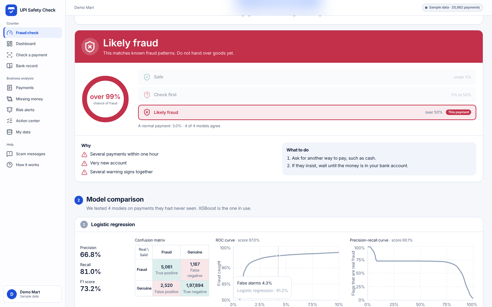
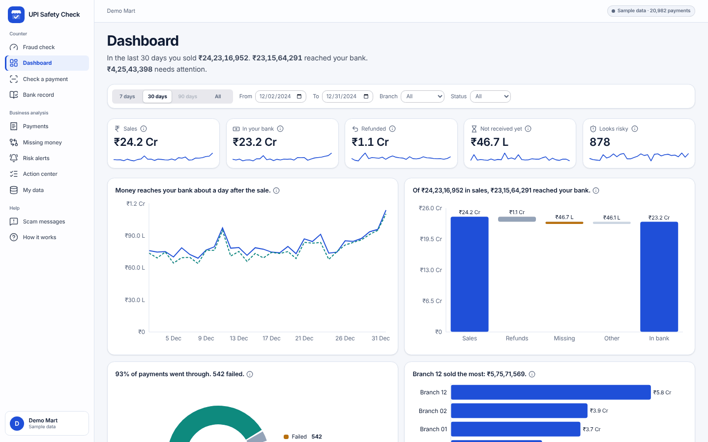
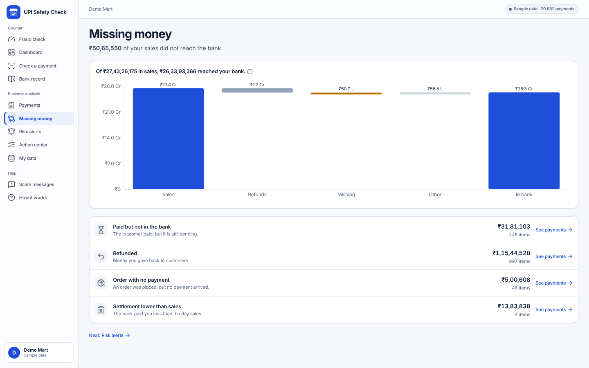
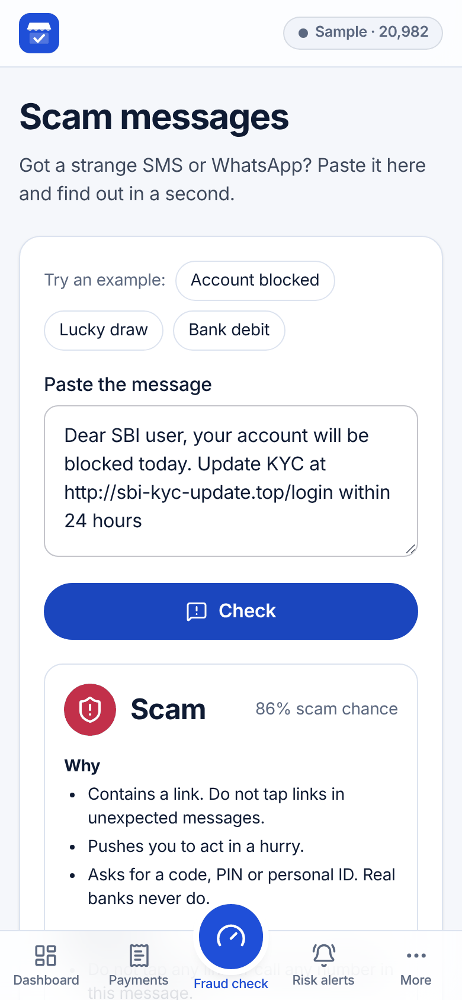

# UPI Safety Check

[](https://upi-safety-check-alpha.vercel.app/) [](https://github.com/amaansiddiqueacademics-a11y/upi-safety-check/actions/workflows/ci.yml) [](LICENSE)
[](backend/.python-version) [](backend/requirements.txt) [](backend/requirements.txt) [](backend/requirements.txt) [](frontend/package.json) [](frontend/package.json) [](frontend/package.json) [](frontend/package.json) [](render.yaml)

A fraud and payment-safety dashboard for small UPI merchants. It answers three questions in plain words: **did the money arrive, where did money go missing, and which payments look like fraud.**

**Try it:** https://upi-safety-check-alpha.vercel.app/ (no sign-up; it opens with a sample shop). The API sleeps after 15 minutes without visits, so the first load after a pause can take about a minute.

Backend: FastAPI + scikit-learn / XGBoost / LightGBM (`backend/`). Frontend: React + Vite + Tailwind + Recharts PWA (`frontend/`). No login, English only.

> **All data and every score here is synthetic.** The four fraud models were trained and tested on synthetic payments in the IEEE-CIS layout, and the Dashboard sample is made from their unseen test period. Nothing says anything about real UPI fraud rates.

| Fraud check | Dashboard |
|---|---|
|  |  |
| **Missing money** | **Scam messages (phone)** |
|  |  |

## Run it

Everything the app needs is in the repository (synthetic data, trained models, sample).

Backend (Python 3.12), in one terminal:
```
cd backend
python -m venv .venv
# Windows:        .venv\Scripts\pip install -r requirements.txt
#                 .venv\Scripts\python -m uvicorn app.main:app --port 8010
# macOS / Linux:  .venv/bin/pip install -r requirements.txt
#                 .venv/bin/python -m uvicorn app.main:app --port 8010
```
PyTorch is only needed to retrain the models, not to run the app.

Frontend (Node 22.12+), in a second terminal:
```
cd frontend
npm install
npm run dev                                              # http://localhost:5173 (proxies /api to :8010)
```
Open http://localhost:5173. The sample business comes pre-analysed in `backend/data/merchant_sample/_analyzed.pkl`, so the server starts in seconds. If you change the sample or the analysis code, the cache is rebuilt automatically on the next start (about half a minute).

Checks (also run by GitHub Actions on every push): `cd backend && pip install -r requirements-dev.txt && ruff check app ml tests && python -m pytest -q` (38 tests) · `cd frontend && npm run lint` · `npm test && npm run build` (17 tests; the build type-checks first)

## The pages

| Group | Page | Route | What it does |
|---|---|---|---|
| Counter | Fraud check | `/` | Score one payment with the 4 models; compare them (precision, recall, F1, confusion matrix, ROC, PR) |
| Counter | Dashboard | `/dashboard` | Sales, money in the bank, refunds, not received, risk; slicers; charts filter each other |
| Counter | Check a payment | `/check` | Bank reference (UTR) + amount: found and matching, found but different, or not found |
| Counter | Bank record | `/ledger` | Money in your bank; add a payment or import a CSV |
| Business | Payments | `/transactions` | 5 tabs with counts, search, filters, detail drawer, CSV export |
| Business | Missing money | `/reconciliation` | One waterfall and four causes with links |
| Business | Risk alerts | `/risk` | Safe / Check / Fraud counts and a review queue (Fraud / Fine marks are saved for the next retrain) |
| Business | Action center | `/actions` | Do now, this week, done |
| Business | My data | `/data` | Upload your four files, and a data explorer with EDA |
| Help | Scam messages | `/messages` | Paste an SMS; compare the 3 message models |
| Help | How it works | `/about` | The flow, how the models were trained and tested, limits |

Every payment can be opened in Fraud check pre-filled from the merchant's own payment history, and every page links to the next one. A user guide is in [HOW-TO-USE.md](HOW-TO-USE.md).

## Folder structure

```
backend/
  app/                 FastAPI app (main.py) and the merchant package: analytics, dashboard, reconcile, risk, explore, fraud and spam models
  data/                the synthetic data (train_transaction.csv.gz, train_identity.csv.gz, _patterns.csv.gz; gzip-compressed, 31 MB), spam.csv, and merchant_sample/ (the Dashboard sample)
  models/              the trained fraud models (fraud_models.joblib), the older upload risk model, the model registry
  ml/                  scripts that regenerate the data, the models and the sample
  tests/               pytest suite
  Dockerfile           backend image (used by Render)
frontend/              React app (src/pages, src/components, src/lib)
render.yaml            Render blueprint for the backend
docs/                  DECISIONS.md (design decisions) and ml/ (evaluation results shown on the Fraud check page)
```

## How the pieces fit

```
data/ (synthetic payments) --ml/train_fraud.py--> models/fraud_models.joblib + docs/ml/fraud_results.json
   |
   +-- test period (days 150-182, never seen) --ml/make_merchant_sample.py--> data/merchant_sample/transactions.csv (scored by XGBoost)
                                                                                 |
   orders, refunds, settlements generated from it (problems planted) --app/merchant/sample.py--> in-memory sample business
                                                                                 |
                      /api/merchant/{dataset}/dashboard | transactions | risk | explore | ... --> the pages
```

- **Models:** time split only (train days 0-119, validation 120-149, test 150-182). Three-zone decision: Block, Check, Approve. Details in [docs/DECISIONS.md](docs/DECISIONS.md).
- **Uploads** (`POST /api/merchant/datasets`) are validated and held in memory for 2 hours. They are scored by the older risk model, not the four fraud models.
- **Review marks** (Fraud / Fine on Risk alerts) are written to `backend/data/review_labels/` (not committed).

## Settings

All optional. The backend reads environment variables; the frontend reads `frontend/.env` (see `frontend/.env.example`).

| Variable | Where | Default | What it does |
|---|---|---|---|
| `VITE_API_BASE` | frontend build | `/api` | Address of the backend API, e.g. `https://<render address>/api` |
| `API_TARGET` | frontend dev server | `http://127.0.0.1:8010` | Where `npm run dev` forwards `/api` |
| `CORS_ORIGINS` | backend | local dev addresses (ports 5173, 4173) | Comma-separated sites allowed to call the API |
| `CORS_ORIGIN_REGEX` | backend | none | Pattern of allowed sites (`render.yaml` allows `*.vercel.app`) |
| `MAX_UPLOADS` | backend | `10` | Uploaded datasets held in memory at once (about 30 MB each) |
| `DISABLE_RATE_LIMIT` | backend | off | Set to `1` to turn off per-visitor limits (tests use this) |
| `MERCHANT_WARM` | backend | on | Set to `0` to skip preparing the sample at start-up |

## Deploy

The frontend is static and goes on **Vercel**. The backend (FastAPI + the trained models) does not fit Vercel functions, so it runs as a Docker service on **Render** (the free plan is enough). The two are joined by one environment variable.

1. **Backend on Render.** New > Blueprint > pick this repository and branch; Render reads `render.yaml` and builds `backend/Dockerfile`. The plan is `free`. Tested in Docker with the free plan's limits (512 MB, 0.1 CPU): the backend is healthy about 20 seconds after starting, uses about 150 MB idle and 240 MB once every page has been used, and stays at about 310 MB with four full-size uploads held (later uploads replace the oldest; `render.yaml` sets `MAX_UPLOADS=4`). It fits because the neural network ships as plain NumPy arrays and needs no PyTorch. At 0.1 CPU an upload of about 20,000 payments takes a minute or two to analyse. Free services sleep after 15 minutes without visits, so the first visit after a pause takes about a minute to wake. When it is live, note its address, for example `https://upi-safety-check-api.onrender.com`. Check `https://<that address>/api/health`. The sample ships with a prepared cache, so the Dashboard opens in a few seconds once the service is awake.
2. **Frontend on Vercel.** Add New > Project > import this repository, branch `main`, and set **Root Directory** to `frontend`. Framework preset: Vite (`frontend/vercel.json` sets the build and the single-page fallback). Under Environment Variables add `VITE_API_BASE` = `https://<the Render address>/api`, then Deploy.
3. **CORS.** The API already accepts any `https://*.vercel.app` address (`CORS_ORIGIN_REGEX` in `render.yaml`). For a custom domain, add it to `CORS_ORIGINS` on Render (comma-separated).

Local Docker test of the backend: `docker build -f backend/Dockerfile -t upi-safety-api .` then `docker run -p 8010:8010 upi-safety-api`.

## Regenerating the data and models (optional)

Only needed to rebuild from scratch. `ml/make_synthetic_ieee.py` copies value pools (amounts, email domains, devices) from the real IEEE-CIS files, which are not in this repository (Kaggle competition rules): download `train_transaction.csv` and `train_identity.csv` into `backend/data/raw/ieee_cis/` first.
```
cd backend
python ml/make_synthetic_ieee.py      # synthetic payments -> data/
pip install -r requirements-train.txt # adds PyTorch, only for retraining
python ml/train_fraud.py              # the 4 models + evaluation (about 10 minutes)
python ml/export_numpy_mlp.py         # store the neural network as NumPy arrays, so the app runs without PyTorch
python ml/make_merchant_sample.py     # the Dashboard sample -> data/merchant_sample/
```

## Data notes

- `data/spam.csv` is the public UCI SMS Spam Collection (licensed CC BY 4.0 by its authors). The optional Indian scam-message set (Shade63) has no licence, so it is **not** included; without it the Scam messages page trains on the English set only. To use it, place `sentinel_dataset_multiclass.csv` in `backend/data/shade63/` (git-ignored).
- The real IEEE-CIS and ULB credit-card datasets are not included.

## Limits

- Synthetic data throughout; the planted problems in orders, refunds and settlements are the only "leakage" the app can find in the sample.
- Fraud check judges card-style signals and has not been tested on real UPI payments.
- Scam message data is template-heavy, so real messages may score lower.
- Rate limiting is in memory only; dataset isolation relies on unguessable ids.

## Authors and licence

Built by **Mohammed Amaan Siddique** and **Abdul Hakim Shaikh**, Vidyalankar Institute of Technology, Mumbai.

The code is released under the [MIT licence](LICENSE). The datasets keep their own terms (see Data notes).
